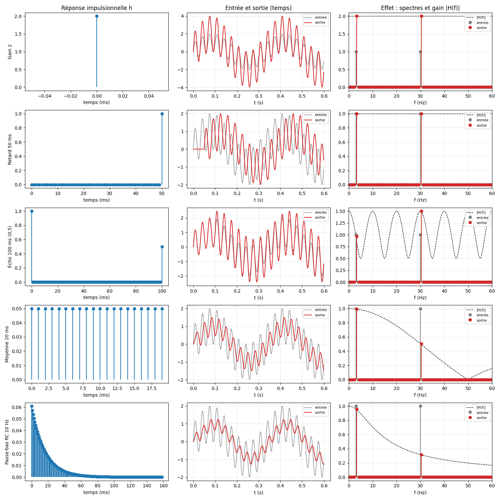

# P1-A1 : convolution et systèmes linéaires invariants (LTI)

Un système LTI est entièrement décrit par sa réponse impulsionnelle h : y[n] = sum_k h[k] x[n-k].
Dans les fréquences, la convolution devient une multiplication : Y(f) = H(f) X(f).

## Contenu
- `FICHE.md` : fiche explicative (comment ça marche, à quoi ça sert en RF, pièges).
- `convolution.py` : convolution directe (`np.convolve`) vs via FFT avec zero padding à len(x)+len(h)-1, et le piège de la convolution circulaire.
- `retard10.py` / `retard10.png` : un retard de 10 échantillons, h[10] = 1 donne y[n] = x[n-10].
- `tracer_systemes.py` / `tracer_systemes.png` : 5 systèmes (gain, retard, écho, moyenne, RC passe-bas) pour une entrée sin 3 Hz + sin 30 Hz. Colonnes : h, entrée/sortie, spectres et |H(f)|.

## Résultats chiffrés
- x=[1,0,2], h=[1,1,1] donne [1,1,3,2,2] (somme 9), identique via FFT.
- x=[2,4,8], h=[0.5,0.5] donne [1,3,6,4] (somme 14).
- Retard de 10 échantillons : x non nul aux indices 5 à 11, y aux indices 15 à 21 (somme 16 des deux côtés).
- Gains |H(f)| du RC 10 Hz : 0.958 à 3 Hz, 0.316 à 30 Hz (relevés sur le tracé).

